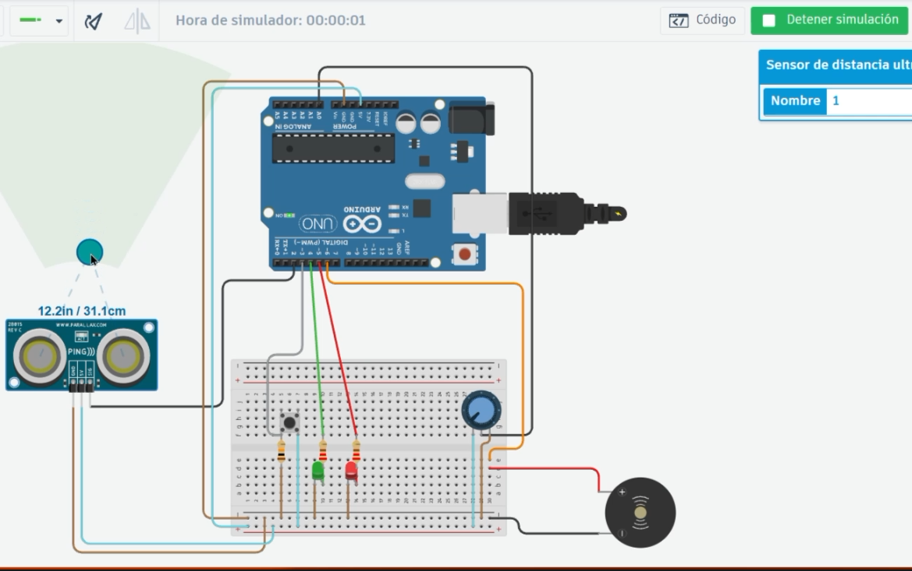
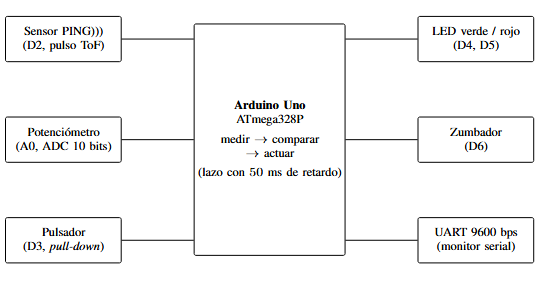

# Embedded Proximity Monitoring and Multimodal Alert System

An **Arduino Uno**-based prototype that detects whether a space is occupied by measuring distance with an ultrasonic sensor, and signals the result with lights and sound. It was designed, simulated in Tinkercad, and mounted on a **1:10 scale model** of a study cubicle at the Faculty of Engineering of Universidad de San Buenaventura, Bogotá campus.

Project for the Digital Circuits course.



## Problem Statement

In the study cubicles and laboratory areas of the Faculty of Engineering, space is oversaturated and poorly managed during peak hours: users have no signage telling them in real time whether a spot is available or occupied. Static posters and paper reservations do not adapt to the changing dynamics of the campus.

This system measures occupancy locally and continuously, and communicates it immediately with visual and acoustic indicators, at low cost and without relying on network infrastructure.

## How It Works

1. The **PING)))** sensor measures the distance to the nearest object or person.
2. A **potentiometer** sets the detection threshold, from 0 to 100 cm.
3. If the distance is less than or equal to the threshold, the **red LED** turns on (occupied); otherwise, the **green LED** turns on (free).
4. Every time the state **changes** (enters or leaves the threshold), the **buzzer** sounds for less than one second.
5. A **pushbutton** mutes or re-enables the buzzer; the LEDs keep working.
6. In every cycle, a telemetry line is sent over **UART** (9600 bps) to the serial monitor.

## Components List

| Qty | Component | Function |
|:--:|---|---|
| 1 | Arduino Uno (ATmega328P) and USB cable | Microcontroller and power supply |
| 1 | PING))) ultrasonic sensor | Distance measurement (time of flight) |
| 1 | Potentiometer | Threshold adjustment (analog input) |
| 1 | Pushbutton | Mute / re-enable the buzzer |
| 1 | 10 kΩ resistor | External *pull-down* for the pushbutton |
| 1 | Green LED | Free space |
| 1 | Red LED | Occupied space / threshold exceeded |
| 2 | 220 Ω resistors | LED current limiting |
| 1 | Piezoelectric buzzer | Acoustic alert |
| 1 | Breadboard and wires | Connections |
| 1 | 1:10 scale model | Support and system integration |

## Wiring Diagram



| Pin | Component | Type |
|:--:|---|---|
| D2 | PING))) sensor (SIG pin) | Input / output (trigger and echo) |
| D3 | Pushbutton with 10 kΩ *pull-down* | Digital input |
| D4 | Green LED (with 220 Ω) | Digital output |
| D5 | Red LED (with 220 Ω) | Digital output |
| D6 | Piezoelectric buzzer | Output (`tone()`) |
| A0 | Potentiometer wiper | Analog input (10-bit ADC) |
| 5 V / GND | Power for the sensor and potentiometer; common ground | — |

The pushbutton connects input D3 to 5 V when pressed; the 10 kΩ resistor to ground keeps the input at a low level at rest. `INPUT_PULLUP` is not used.

## Usage Instructions

### Upload the Code

1. Install the [Arduino IDE](https://www.arduino.cc/en/software).
2. Open `monitoreo_proximidad/monitoreo_proximidad.ino`.
3. Select the **Arduino Uno** board and the corresponding port, then click **Upload**.

### Test the System

1. Open the **Serial Monitor** at **9600 baud**. You will see lines like:

   ```
   Distance: 31 cm | Threshold: 40 cm | Buzzer: ON -> INSIDE (RED)
   ```

2. Turn the **potentiometer** to adjust the threshold (`Threshold`).
3. Bring an object close to the sensor: within the threshold the red LED turns on and the buzzer sounds once; when you move it away the green LED returns and the buzzer sounds again.
4. Press the **pushbutton** to mute the buzzer (`MUTED`) and press it again to re-enable it (`ON`).
5. If the sensor receives no echo, `Distance` is `999` and the LED stays green.

### Test in Simulation

The circuit can be simulated in Tinkercad Circuits with the same components and the same code.

<!-- Add the Tinkercad project link here -->

## Repository Structure

```
.
├── README.md
├── monitoreo_proximidad/
│   └── monitoreo_proximidad.ino   # Commented source code
└── docs/
    ├── esquematico.png            # Wiring diagram
    └── simulacion_tinkercad.png   # Simulation screenshot
```

## Limitations and Improvements

- The loop uses `delay()` (50 ms per cycle and 300 ms after each alert), so the sensor is not read during that time. Replacing them with time control using `millis()` is proposed.
- Sound-absorbing surfaces or surfaces with large incidence angles scatter the echo.
- The conversion to centimeters assumes a constant speed of sound (29 µs/cm).
- Proposed improvements: temperature compensation, sensor array, OLED display, and sending data to the cloud (for example, with an ESP32).

## Authors

- Juan Sebastian Rios Socha
- Gustavo Pacheco
- Ivan Romero
- Santiago Cabrera

Universidad de San Buenaventura, Bogotá campus. Faculty of Engineering.
